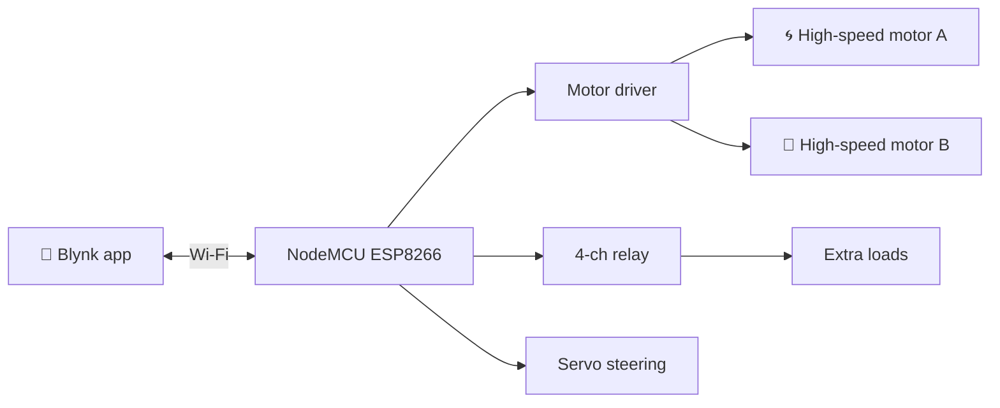

<div align="center">


### 🛥️ A lightweight hovercraft that rides on a cushion of air — steered over Wi-Fi.


</div>

---

## 📌 At a glance

> A lightweight hovercraft boat driven by **high-speed DC motors**, with a **servo** for steering. A **NodeMCU** connects it to the **Blynk** app, so the whole craft is controlled from a phone.

---

## 🔄 How it works



| Part | Role |
|---|---|
| **NodeMCU (ESP8266)** | Wi-Fi link and control |
| **2 × high-speed DC motors** | Propulsion |
| **Motor driver** | Forward / reverse for each motor |
| **4-channel relay** | Extra switched loads |
| **Servo** | Steering |

---

## 🎮 Controls

| Blynk pin | Action |
|:---:|---|
| `V4` / `V5` | Motor A forward / reverse |
| `V6` / `V7` | Motor B forward / reverse |
| `V0` – `V3` | Relays 1–4 |

---

## 💻 Code

[`IOT_based_Hovercraft.ino`](IOT_based_Hovercraft.ino):

```cpp
BLYNK_WRITE(V4) {                   // motor A forward
  if (param.asInt()) {
    digitalWrite(ENB, HIGH);
    digitalWrite(MOTORB_1, LOW);
    digitalWrite(MOTORB_2, HIGH);
  } else {
    digitalWrite(ENB, LOW);
  }
}
```

<details>
<summary><b>▶ How to run it</b></summary>

1. Install the **ESP8266 board package** and **Blynk** library
2. Enter **your own** Blynk auth token and Wi-Fi details
3. Connect the motor driver, relays and servo as defined at the top of the sketch
4. Add buttons for `V0`–`V7` in the Blynk app

</details>

---

## 🧠 What I learned

- ⚖️ **Lightweight design** — every gram matters on an air cushion
- 📶 **IoT control** of a craft that has no wheels and very little friction

---

<div align="center">

### 👋 Built by **Ajay Arjun Mannolkar**
[](https://technolkar.github.io)
[](https://www.linkedin.com/in/ajaymannolkar)
[](https://www.youtube.com/@TechnolkarInnovations)


</div>
